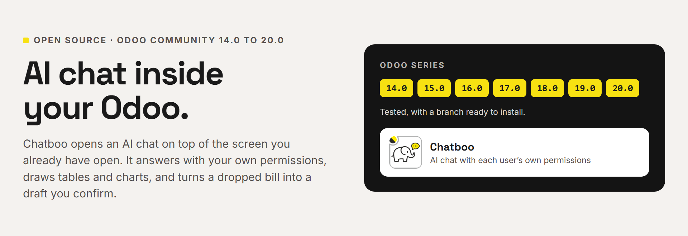
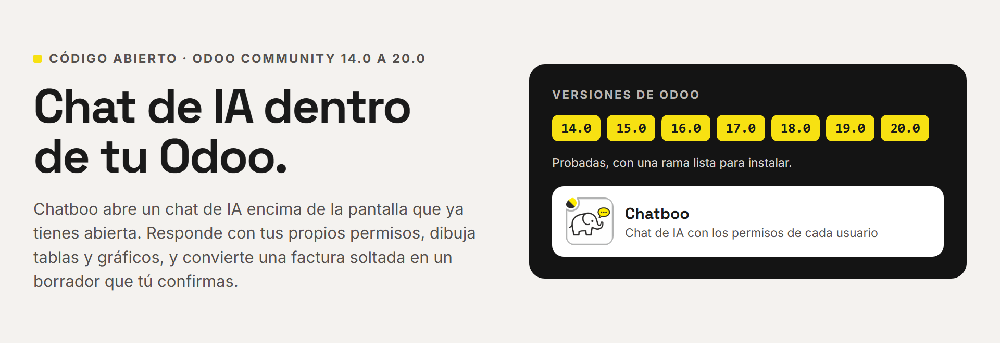

# Chatboo (pns_ai_chatboo)



**[English](#english) · [Español](#español) · [www.patanegra.com](https://www.patanegra.com/chatboo.html)**

## English

**AI for all your clients, without leaving Odoo.** Chatboo opens an AI chat
on top of the screen your client is already using. It knows what is on that
screen, answers with the user's own permissions, and goes away with one
click. It runs on the AI Engine ([`pns_ai_mcp`](https://github.com/patanegra-soft/pns_ai_mcp)).
Odoo **14.0** to **20.0**.

### The pain

**To use AI, people have to leave Odoo.**
They export spreadsheets into another application, or hand their Odoo
password to an outside service. The answer lands somewhere else, and the
work stops while they copy it back. Chatboo opens on top of the screen they
are already on.

| | |
| :--- | :--- |
| **01 — Waiting while the AI thinks?** | It is a layer you put on and take off. Close it, keep working, and the elephant tells you when the answer is ready. |
| **02 — Does every question cost money?** | Turn what you repeat into a skill. Most of the time it runs without calling the AI: zero cost, same answer every time. |
| **03 — Explaining which record you mean, every time?** | It knows what is on screen. If several records match, click the row and that is it. |

### What you get

**On the screen they already use**
- The elephant in the top bar opens the chat over the current screen. Nobody leaves the record they were on.
- It knows which record or list is on screen.
- When several records could match, it lists them. Click a row and the next question is about that one.
- Conversations are saved and can be reopened. Each user sees only their own.

**Work while it thinks**
- Close the chat and carry on. The answer keeps coming.
- When it is ready, the elephant shows a bell and Odoo shows a notice.
- A long answer can be stopped from the chat.

**Answers they can use**
- Tables whose cells open the record, and charts drawn in the chat.
- Export an answer to PDF, Excel or Word, or copy it.
- Attach, drop or paste (Ctrl+V) a spreadsheet, a Word file, a PDF, an image or plain text, and ask about it.
- Answers can be read aloud.

**Skills that cost nothing**
- Type `/` and pick a skill: a procedure written once, for the client's routines.
- Tables and charts from a skill come from code, not from the AI. Same data, same answer.
- A good answer can be saved as a new skill from the chat itself.
- That knowledge is a service you sell and maintain at each client.

**Safe for your client**
- It reads as the person who asks: their access rights, record rules and companies.
- A change is a plan with a Confirm button. Only users you allow can confirm.

**Put it on, take it off**
- A plain Odoo module: no external server, no build tools.
- Apache 2.0. No fee per user, per database or per year.
- Uninstall it from Apps like any other module.

### Vendor bills from a document

Drop a supplier's bill on the chat (a PDF, a spreadsheet, or a photo or scan in jpg, png or webp), or paste a photo or a screenshot with Ctrl+V, and say what you want: *register it*, *is this one already booked?*, *create the contact*. Chatboo reads the document and answers with a plan you see before anything happens:

1. **The vendor.** Chatboo looks it up by the tax id printed on the bill, then by name. If it is not in Contacts, the first step of the plan creates it with the name, tax id and address printed on the document.
2. **The bill, in draft.** Vendor, bill date, the supplier's invoice number as the reference, the document's currency when it is not yours, and one line per taxed base with the company's purchase taxes that reproduce what is printed (one VAT rate, or GST + PST on the same base, or a withholding) and the expense account that vendor's last bills used (or the one most used in the company). When no tax of yours matches the printed figures, the line goes without tax and Chatboo says which tax is missing.
3. **Duplicates.** If that vendor already has a bill with the same number, or the same total and date, Chatboo names it and proposes nothing.

Press Confirm and the draft opens. Several documents dropped together give one plan each, named after its file, vendor and total, so you confirm them one by one. Nothing is posted: the draft waits for the accountant like any other.

**Till receipts and card slips.** A till receipt (a simplified invoice) is a vendor bill too: the shop is the vendor, the receipt number is the reference. A receipt with subtotal and tax apart is read like a bill; one that prints only a tax-inclusive total gets its base worked out from the rate printed on it, and if no rate is printed Chatboo asks instead of guessing. A receipt without the shop's tax id is normal in many countries: the vendor is found by name. A card terminal slip is proof of a payment, not a bill: Chatboo never books it. It looks for a bill of that merchant with that amount around that date and tells you whether it is booked and paid, or that the receipt is still needed.

It needs the Invoicing app and the rights to create vendor bills, because the plan runs as you. A PDF with text costs one chat turn with your own provider; a photo or a scan is transcribed once by a provider with the **Vision** role.

**On Odoo Community.** Chatboo does this on Odoo Community, 14.0 to 20.0, with your own provider and your own key: it shows the whole plan before Confirm, creates the vendor when it is missing and warns of duplicates.

### Skills

A skill is a procedure written once, in code. Type `/` in the chat and pick one, or ask in your own words: each skill also answers to its own phrases.

- **Almost free.** The figures come from code, not from the AI. A skill with no arguments, or with named ones (`months=6`), calls no AI. Arguments in your own words (`the last two years`) take one very short call, and the same words are remembered the next time. Only two cases spend real tokens: the report of `/financial-health`, and a photo or a scan in `/bill-draft`.
- **It asks for what is missing.** The skill asks in the chat; `/top-sales` asks one question at a time. If your next message is about something else, the skill lets go and the chat carries on.
- **It only reads.** Skill code runs in a read-only box, with the rights of the person who asks, in the active company. A skill that proposes a record opens its form; only Save writes.
- **Each one its own screen.** A chart, cards you can move around the chat, or a full page.
- **Yours too.** A good answer can be saved as a new skill from the chat. The ones in the module are a starting point; each client's own are written by their consultant.

#### /bill-draft — the vendor bill form, for a vendor you already have

The quick, free version of the above, for vendors that are already in Contacts. Attach the bill and type `/bill-draft`: Chatboo finds the vendor by the tax id printed on the document, the bill date and the largest amount, warns of a bill of that vendor with the same total and date, and opens the vendor bill form with the vendor and the date filled in. Lines, taxes and the reference are yours; nothing is saved until you press Save. A vendor that is not in Contacts yet, or the lines filled in: drop the bill and ask (see *Vendor bills from a document*). A PDF with text costs nothing; a photo or a scan uses the Vision provider once.

#### /billing — billing by month

Posted customer invoices per month, untaxed, as a chart. The last 12 months by default, `months=6` for fewer, or `year=2025` for one calendar year.

#### /dashboard — business dashboard

Nine chart cards: this month, this quarter and the year so far, each one by sales team (or journal), top customers and trend. From posted customer invoices. The cards can be moved around the chat. No arguments.

#### /sales-board — sales board

Cards you can drag, minimize, maximize or close; your browser keeps the layout. Key figures, quoted and confirmed by month and by salesperson, top customers, the largest open quotations and, with CRM installed, the pipeline by stage. Last 12 months, untaxed. No arguments.

#### /top-sales — top 10

It asks what to rank (customers, products or salespeople) and how many months back, one question at a time. Answer with a number. `/top-sales 2 6` answers both at once. Then it charts the top 10 by untaxed sales.

#### /pipeline — sales pipeline

A page over the open CRM opportunities: key figures, funnel by stage, weighted forecast by expected close month, each salesperson's pipeline, the win rate of the last 12 months, and stalled deals (no stage change in 21 days, or `stalled_days=…`). Narrow it with `team=…` or `salesperson=…`.

#### /customer-360 — everything about one customer

`/customer-360 ACME`, by name, tax id or e-mail. One page: profile, revenue for the last 24 months, open and overdue invoices, opportunities, meetings, planned activities and the latest messages. A health score from 0 to 100 weighs payment discipline, the trend against the year before, and how recent the last invoice is. It shows only what the person asking can read; apps that are not installed are left out. If several customers match, it shows one and lists the others.

#### /financial-health — financial health

A written report over the last 12 months (`months=24` for two years): sales and purchases against a year earlier, money owed both ways, cash, days to collect and customer concentration. The figures come from code; the AI writes the analysis, the risks and the recommendations on top of them, in the language of the person asking.

#### /forecast — weather

Daily weather from Open-Meteo, a public site on the URL whitelist: sky, temperatures, rain, wind, UV, sunrise and sunset. With no place, the company's city and the next 7 days; `place=Paris, Rome days=3` for others. The place names go to Open-Meteo; no AI is called.

#### /users — users, for AI administrators

Every user, archived included, with type, last login and whether they are connected now. `online=true` lists only who is connected. Each name opens the user. Only AI administrators see this skill.

### What it does not do

- **No AI of its own.** Providers, agents and approvals live in the AI Engine. Without a provider with the **Conversation** role, the chat has no one to ask.
- **Not for every user by default.** Only users with **AI Conversational** and a generated API key can use it.
- **No changes without a person.** The AI proposes; a user with **AI Writer** presses Confirm.
- **Not before 14.0.** Tested and published from 14.0 to 20.0; 13.0 and older do not run (see *Odoo versions*).

### Questions

**Where do the questions go?** To the providers set up in the AI Engine, in the order of the agent's list. A skill that runs without the AI sends nothing out.

**Is the voice an outside service?** No. Reading an answer aloud uses the browser's own voice.

**Is Chatboo an MCP server?** No. The MCP server is in the AI Engine (`/mcp`). Chatboo is the chat inside Odoo, and it talks to the engine through PAAP, inside the same Odoo.

**Can I use the engine without Chatboo?** Yes. The AI Engine alone serves Cursor and other MCP clients.

### Getting started

1. **Install.** From the Odoo Apps Store, download Chatboo: the store brings PNS AI Engine and PNS Base. From git, clone the three on the same series (from `14.0` to `20.0`; the example uses `20.0`):

   ```bash
   mkdir -p ~/odoo/pns && cd ~/odoo/pns
   for r in pns_base pns_ai_mcp pns_ai_chatboo; do
     git clone -b 20.0 --depth 1 https://github.com/patanegra-soft/$r
   done
   ```

   Each clone is one more entry in `addons_path` (`~/odoo/pns/pns_base,~/odoo/pns/pns_ai_mcp,~/odoo/pns/pns_ai_chatboo`). On Odoo 14, first run `pip install "openpyxl>=3.1.2"`. Restart Odoo, *Apps → Update Apps List* and install **Chatboo**; the other two come with it.
2. **Set up the AI Engine.** Chatboo talks to the AI through `pns_ai_mcp`. Follow its [Getting started](https://github.com/patanegra-soft/pns_ai_mcp#getting-started): AI administrator, your access and the providers. Unlike an MCP client, which brings its own model, Chatboo runs the model from Odoo, so it needs at least one.
3. **Choose your providers.**
   - **To try it, one is enough:** a multimodal model (text and images) with the **Conversation** and **Vision** roles ticked. Everything in this README works with it.
   - **For the best results, several, one per role.** Each role is a different kind of job, and the engine sends each to the provider that holds it, in the order you set, with the next one as backup. Chatboo uses five: **Conversation** (the dialogue: a large model), **Vision** (reading a photo or a scan; needed for bills and receipts that are not a PDF with text), **Design** (laying out a Canvas page), **Parser** (turning a short phrase into the arguments of a skill; a small, cheap model is enough) and **Decision** (a yes or no with a confidence, used when a question could fit several areas of knowledge; it needs a provider whose protocol can choose, such as SystemOne; without one, the word match decides alone). A role nobody holds falls back to Conversation, except Decision, which then answers no.
   - **A broker makes this easy.** A service that serves many models behind one key and one endpoint (OpenRouter, Together AI, Fireworks, DeepInfra, Hugging Face Inference, or a LiteLLM proxy of your own) is one provider per role in the engine, each with the model you choose, and one bill. All of them speak the OpenAI-compatible protocol; OpenRouter also has its own. The engine ships an OpenRouter example with no key, in `static/examples/providers/` of `pns_ai_mcp`.

**Done.** Click the elephant in the top bar.

### For IT staff

#### How it fits

```
pns_ai_chatboo  ──PAAP──▶  pns_ai_mcp  ──▶  AI providers
  (conversation)             (engine)
```

Chatboo owns the conversation: sessions, the chat turn (streamed), the
screen it is opened on and the interface (the app and the overlay from the
top bar). Providers, agents, tools and the AI loop belong to the engine;
Chatboo talks to it through PAAP (Patanegra Application Agent Protocol).
It depends on `web`, `bus`, `mail`, `pns_base` and `pns_ai_mcp`.

A picked row travels with the next message as `{model, id, label}`, so the
engine takes it as the subject instead of searching the name again. The
pick is spent by that message.

#### Repository layout

`main` is one tree for every series. A flat branch (`14.0` … `20.0`) is that tree built for one series, ready for the addons path.

| Path | Contents |
| :--- | :--- |
| `common/` | Version-agnostic code, skills, contexts, data, Apps sheet |
| `stacks/owl1/pns_ai_chatboo/` | Odoo 14 and 15 |
| `stacks/owl2/pns_ai_chatboo/` | Odoo 16 to 19 |
| `stacks/owl3/pns_ai_chatboo/` | Odoo 20 and later |

The installer overlays `common/` then the stack; a stack file with the same
path wins. Edit agnostic files only in `common/`. Build a flat module with
`./install_flat.sh 19.0 /path/to/addons`.

Python: on 14, use a current `openpyxl` (old wheels break with recent
NumPy). On 19 there is nothing extra.

#### Odoo versions

| Series | Status |
| :--- | :--- |
| 14.0 – 20.0 | Tested. Flat branch published. |
| 13.0 and older | Not supported. |

Odoo 13 has no OWL, which the chat is built on. Odoo 8 to 12 run on a
Python older than 3.7, which the engine needs. The suite keeps three stacks (`owl1` for 14.0 and 15.0, `owl2` for 16.0 to 19.0, `owl3` for 20.0 and later).

#### Tests

| Where you are | What runs |
| :--- | :--- |
| `main` | `python -m pytest unit_tests`, with no Odoo. Then the Odoo tests, after `./install_flat.sh 19.0 <dir>`. |
| A flat branch (`14.0` … `20.0`) | The Odoo tests in `tests/`. The unit tests live on `main`. |

```bash
odoo-bin -d <db> -i pns_ai_chatboo --test-enable --stop-after-init --test-tags /pns_ai_chatboo
```

### License, marks, training

Apache-2.0 — see [LICENSE](LICENSE) and [NOTICE](NOTICE).
Chatboo™, the elephant-and-speech-bubble device, PATANEGRA Soft™ and PAAP™
are trademarks of PATANEGRA Soft SL; the license does not grant them.
TDM / AI training is allowed (TDMRep `tdm-reservation = 0`).

Security: [SECURITY.md](SECURITY.md). Bugs, ideas and questions: [CONTRIBUTING.md](CONTRIBUTING.md).

---

## Español



**IA para todos tus clientes, sin salir de Odoo.** Chatboo abre un chat de IA
encima de la pantalla que tu cliente ya está usando. Sabe qué hay en esa
pantalla, responde con los permisos del propio usuario y se quita con un
clic. Funciona sobre el Motor de IA ([`pns_ai_mcp`](https://github.com/patanegra-soft/pns_ai_mcp)).
Odoo **14.0** a **20.0**.

### El dolor

**Para usar IA hay que salir de Odoo.**
Se exportan Excels a otra aplicación, o se le da la contraseña de Odoo a un
servicio de fuera. La respuesta llega a otro sitio y el trabajo se para
mientras se copia de vuelta. Chatboo se abre encima de la pantalla en la que
ya estás.

| | |
| :--- | :--- |
| **01 — ¿Esperar mirando cómo piensa la IA?** | Es una capa de quita y pon. La cierras, sigues trabajando y el elefante te avisa cuando la respuesta está lista. |
| **02 — ¿Cada pregunta cuesta dinero?** | Lo que repites lo conviertes en un skill. Casi siempre se ejecuta sin llamar a la IA: coste cero y la misma respuesta cada vez. |
| **03 — ¿Explicarle cada vez de qué registro hablas?** | Sabe qué hay en pantalla. Si varios encajan, pinchas la fila y listo. |

### Qué te llevas

**En la pantalla que ya usan**
- El elefante de la barra superior abre el chat encima de la pantalla actual. Nadie sale del registro en el que estaba.
- Sabe qué registro o qué lista hay en pantalla.
- Si varios registros encajan, los enseña. Pinchas una fila y la siguiente pregunta va sobre esa.
- Las conversaciones se guardan y se pueden reabrir. Cada usuario ve solo las suyas.

**Trabaja mientras piensa**
- Cierras el chat y sigues. La respuesta sigue llegando.
- Cuando está lista, el elefante enseña una campanita y Odoo muestra un aviso.
- Una respuesta larga se puede parar desde el chat.

**Respuestas que sirven**
- Tablas cuyas celdas abren el registro, y gráficos dibujados en el chat.
- Exportar una respuesta a PDF, Excel o Word, o copiarla.
- Adjuntar, soltar o pegar (Ctrl+V) un Excel, un Word, un PDF, una imagen o un texto, y preguntar sobre él.
- Las respuestas se pueden leer en voz alta.

**Skills que no cuestan nada**
- Escribes `/` y eliges un skill: un procedimiento escrito una vez, para las rutinas del cliente.
- Las tablas y gráficos de un skill salen del código, no de la IA. Mismos datos, misma respuesta.
- Una buena respuesta se puede guardar como skill nuevo desde el propio chat.
- Ese conocimiento es un servicio que vendes y mantienes en cada cliente.

**Seguro para tu cliente**
- Lee como la persona que pregunta: sus permisos, sus reglas de registro y sus compañías.
- Un cambio es un plan con un botón Confirmar. Solo confirman los usuarios que tú permitas.

**Se pone y se quita**
- Un módulo de Odoo normal: sin servidor externo, sin herramientas de compilación.
- Apache 2.0. Sin cuota por usuario, por base de datos ni por año.
- Se desinstala desde Aplicaciones como cualquier otro.

### Facturas de proveedor desde un documento

Suelta en el chat la factura de un proveedor (un PDF, una hoja de cálculo, o una foto o un escaneado en jpg, png o webp), o pega una foto o una captura con Ctrl+V, y di qué quieres: *regístrala*, *¿esta ya está contabilizada?*, *crea el contacto*. Chatboo lee el documento y responde con un plan que ves antes de que pase nada:

1. **El proveedor.** Chatboo lo busca por el NIF impreso en la factura y después por el nombre. Si no está en Contactos, el primer paso del plan lo crea con el nombre, el NIF y la dirección que trae el documento.
2. **La factura, en borrador.** Proveedor, fecha, el número de factura del proveedor como referencia, la moneda del documento si no es la tuya, y una línea por base gravada con los impuestos de compra de la empresa que reproducen lo impreso (un tipo de IVA, o GST + PST sobre la misma base, o una retención) y la cuenta de gasto que usaron las últimas facturas de ese proveedor (o la más usada en la empresa). Si ningún impuesto tuyo cuadra con las cifras impresas, la línea va sin impuesto y Chatboo dice cuál falta.
3. **Duplicados.** Si ese proveedor ya tiene una factura con ese número, o con el mismo total y la misma fecha, Chatboo la nombra y no propone nada.

Pulsas Confirmar y se abre el borrador. Si sueltas varios documentos a la vez, sale un plan por documento, con su fichero, su proveedor y su total en el título, y los confirmas de uno en uno. No se contabiliza nada: el borrador espera al contable como cualquier otro.

**Tickets y recibos de datáfono.** Un ticket (factura simplificada) también es una factura de proveedor: el comercio es el proveedor, el número de ticket es la referencia. Un ticket con base e impuesto por separado se lee como una factura; uno que solo trae el total con el impuesto incluido saca la base del tipo que viene impreso, y si no viene el tipo Chatboo pregunta en vez de adivinar. Un ticket sin el NIF del comercio es lo normal en muchos países: el proveedor se busca por nombre. El recibo del datáfono es la prueba de un pago, no una factura: Chatboo nunca lo contabiliza. Busca una factura de ese comercio con ese importe en esas fechas y te dice si está registrada y pagada, o que aún falta el ticket.

Hace falta la app de Facturación y permiso para crear facturas de proveedor, porque el plan corre como tú. Un PDF con texto cuesta un turno de chat con tu propio proveedor; una foto o un escaneado los transcribe una vez un proveedor con el rol **Visión**.

**En Odoo Community.** Chatboo lo hace en Odoo Community, de la 14.0 a la 20.0, con tu propio proveedor y tu propia clave: enseña el plan entero antes de Confirmar, crea el proveedor si falta y avisa de duplicados.

### Skills

Un skill es un procedimiento escrito una vez, en código. Escribe `/` en el chat y elige uno, o pregunta con tus palabras: cada skill responde también a sus propias frases.

- **Casi gratis.** Las cifras salen del código, no de la IA. Un skill sin argumentos, o con argumentos con nombre (`months=6`), no llama a la IA. Los argumentos dichos a tu manera (`los dos últimos años`) cuestan una llamada muy corta, y las mismas palabras se recuerdan la próxima vez. Solo dos casos gastan de verdad: el informe de `/financial-health` y una foto o un escaneado en `/bill-draft`.
- **Pregunta lo que le falta.** El skill lo pide en el chat; `/top-sales` pregunta de una en una. Si tu siguiente mensaje va de otra cosa, el skill se suelta y el chat sigue.
- **Solo lee.** El código del skill corre en una caja de solo lectura, con los permisos de quien pregunta y en la empresa activa. Un skill que propone un registro abre su formulario; solo Guardar escribe.
- **Cada uno con su pantalla.** Un gráfico, tarjetas que se mueven por el chat o una página entera.
- **También los tuyos.** Una buena respuesta se guarda como skill nuevo desde el propio chat. Los que trae el módulo son un punto de partida; los de cada cliente los escribe su consultor.

#### /bill-draft — el formulario de factura, para un proveedor que ya tienes

La versión rápida y gratis de lo anterior, para proveedores que ya están en Contactos. Adjunta la factura y escribe `/bill-draft`: Chatboo busca el proveedor por el NIF impreso en el documento, la fecha y el importe mayor, avisa si ese proveedor ya tiene una factura con el mismo total y la misma fecha, y abre el formulario de factura de proveedor con el proveedor y la fecha puestos. Las líneas, los impuestos y la referencia los pones tú; no se guarda nada hasta que pulsas Guardar. Un proveedor que aún no está en Contactos, o las líneas rellenas: suelta la factura y pídelo (ver *Facturas de proveedor desde un documento*). Un PDF con texto no cuesta nada; una foto o un escaneado usan una vez el proveedor de Visión.

#### /billing — facturación por mes

Facturas de cliente publicadas por mes, sin impuestos, en un gráfico. Los últimos 12 meses por defecto, `months=6` para menos, o `year=2025` para un año natural.

#### /dashboard — cuadro de mando

Nueve tarjetas con gráficos: este mes, este trimestre y lo que va de año, cada uno por equipo de ventas (o diario), mejores clientes y tendencia. Sale de las facturas de cliente publicadas. Las tarjetas se mueven por el chat. Sin argumentos.

#### /sales-board — tablero de ventas

Tarjetas que arrastras, minimizas, maximizas o cierras; tu navegador guarda cómo las dejas. Cifras clave, presupuestado y confirmado por mes y por comercial, mejores clientes, los presupuestos abiertos más grandes y, si está CRM, el embudo por etapa. Últimos 12 meses, sin impuestos. Sin argumentos.

#### /top-sales — los 10 primeros

Pregunta qué ordenar (clientes, productos o comerciales) y cuántos meses atrás, de una en una. Contesta con un número. `/top-sales 2 6` contesta las dos a la vez. Luego dibuja los 10 primeros por ventas sin impuestos.

#### /pipeline — embudo de ventas

Una página sobre las oportunidades abiertas del CRM: cifras clave, embudo por etapa, previsión ponderada por mes de cierre esperado, el embudo de cada comercial, la tasa de éxito de los últimos 12 meses y las oportunidades paradas (sin cambiar de etapa en 21 días, o `stalled_days=…`). Se acota con `team=…` o `salesperson=…`.

#### /customer-360 — todo sobre un cliente

`/customer-360 ACME`, por nombre, NIF o correo. Una página: ficha, ingresos de los últimos 24 meses, facturas abiertas y vencidas, oportunidades, reuniones, actividades previstas y los últimos mensajes. Una nota de salud de 0 a 100 pesa la puntualidad en el pago, la tendencia frente al año anterior y lo reciente de la última factura. Solo enseña lo que puede leer quien pregunta; las apps que no están instaladas se quedan fuera. Si casan varios clientes, enseña uno y lista los demás.

#### /financial-health — salud financiera

Un informe escrito de los últimos 12 meses (`months=24` para dos años): ventas y compras frente al año anterior, lo que te deben y lo que debes, tesorería, días de cobro y concentración de clientes. Las cifras salen del código; la IA escribe encima el análisis, los riesgos y las recomendaciones, en el idioma de quien pregunta.

#### /forecast — el tiempo

El tiempo por días de Open-Meteo, un sitio público de la lista de URL permitidas: cielo, temperaturas, lluvia, viento, UV, salida y puesta de sol. Sin sitio, la ciudad de la empresa y los 7 días siguientes; `place=Paris, Rome days=3` para otros. Los nombres de los sitios van a Open-Meteo; no se llama a la IA.

#### /users — usuarios, para administradores de IA

Todos los usuarios, archivados incluidos, con su tipo, último acceso y si están conectados ahora. `online=true` lista solo a los conectados. Cada nombre abre el usuario. Solo los administradores de IA ven este skill.

### Qué no hace

- **No trae IA propia.** Los proveedores, los agentes y las aprobaciones viven en el Motor de IA. Sin un proveedor con el rol **Conversación**, el chat no tiene a quién preguntar.
- **No es para todos los usuarios de entrada.** Solo lo usan quienes tienen **IA Conversacional** y una clave API generada.
- **No cambia nada sin una persona.** La IA propone; un usuario con **IA Escritor** pulsa Confirmar.
- **No antes de la 14.0.** Probado y publicado de la 14.0 a la 20.0; la 13.0 y anteriores no funcionan (ver *Versiones de Odoo*).

### Preguntas

**¿Adónde van las preguntas?** A los proveedores configurados en el Motor de IA, en el orden de la lista del agente. Un skill que se ejecuta sin la IA no envía nada fuera.

**¿La voz es un servicio de fuera?** No. Leer una respuesta en voz alta usa la voz del propio navegador.

**¿Chatboo es un servidor MCP?** No. El servidor MCP está en el Motor de IA (`/mcp`). Chatboo es el chat dentro de Odoo y habla con el motor por PAAP, dentro del mismo Odoo.

**¿Puedo usar el motor sin Chatboo?** Sí. El Motor de IA solo ya sirve a Cursor y a otros clientes MCP.

### Puesta en marcha

1. **Instala.** Desde la tienda de Odoo, descarga Chatboo: la tienda trae PNS AI Engine y PNS Base. Desde git, clona los tres en la misma serie (de la `14.0` a la `20.0`; el ejemplo usa la `20.0`):

   ```bash
   mkdir -p ~/odoo/pns && cd ~/odoo/pns
   for r in pns_base pns_ai_mcp pns_ai_chatboo; do
     git clone -b 20.0 --depth 1 https://github.com/patanegra-soft/$r
   done
   ```

   Cada clon es una entrada más del `addons_path` (`~/odoo/pns/pns_base,~/odoo/pns/pns_ai_mcp,~/odoo/pns/pns_ai_chatboo`). En Odoo 14, antes, `pip install "openpyxl>=3.1.2"`. Reinicia Odoo, *Aplicaciones → Actualizar lista de aplicaciones* e instala **Chatboo**; los otros dos entran con él.
2. **Configura el Motor de IA.** Chatboo habla con la IA a través de `pns_ai_mcp`. Sigue su [puesta en marcha](https://github.com/patanegra-soft/pns_ai_mcp#puesta-en-marcha): administrador de IA, tu acceso y los proveedores. A diferencia de un cliente MCP, que trae su propio modelo, Chatboo ejecuta el modelo desde Odoo, así que necesita al menos uno.
3. **Elige los proveedores.**
   - **Para probar, con uno basta:** un modelo multimodal (texto e imágenes) con los roles **Conversación** y **Visión** marcados. Todo lo de este README funciona con él.
   - **Para el mejor resultado, varios, uno por rol.** Cada rol es un tipo de trabajo distinto, y el motor manda cada uno al proveedor que lo tiene, en el orden que pongas, con el siguiente de respaldo. Chatboo usa cinco: **Conversación** (el diálogo: un modelo grande), **Visión** (leer una foto o un escaneado; hace falta para facturas y tickets que no sean un PDF con texto), **Diseño** (maquetar una página del Canvas), **Parser** (convertir una frase corta en los argumentos de un skill; vale un modelo pequeño y barato) y **Decisión** (un sí o no con confianza, para cuando una pregunta encaja en varias áreas de conocimiento; necesita un proveedor cuyo protocolo sepa elegir, como SystemOne; sin él, decide solo la coincidencia de palabras). Un rol que nadie tiene cae en Conversación, salvo Decisión, que entonces responde no.
   - **Un bróker lo pone fácil.** Un servicio que sirve muchos modelos con una sola clave y un solo endpoint (OpenRouter, Together AI, Fireworks, DeepInfra, Hugging Face Inference, o un proxy LiteLLM propio) es un proveedor por rol en el motor, cada uno con el modelo que elijas, y una sola factura. Todos hablan el protocolo compatible con OpenAI; OpenRouter tiene además el suyo. El motor trae un ejemplo de OpenRouter sin clave en `static/examples/providers/` de `pns_ai_mcp`.

**Listo.** Pulsa el elefante de la barra superior.

### Para el equipo de IT

#### Cómo encaja

```
pns_ai_chatboo  ──PAAP──▶  pns_ai_mcp  ──▶  proveedores de IA
  (conversación)             (motor)
```

Chatboo lleva la conversación: las sesiones, el turno del chat (en
streaming), la pantalla desde la que se abre y la interfaz (la aplicación y
la capa que sale de la barra superior). Los proveedores, los agentes, las
herramientas y el bucle de la IA son del motor; Chatboo le habla por PAAP
(Patanegra Application Agent Protocol). Depende de `web`, `bus`, `mail`,
`pns_base` y `pns_ai_mcp`.

Una fila pinchada viaja con el siguiente mensaje como `{model, id, label}`,
así el motor la toma como el asunto en vez de volver a buscar el nombre. Ese
mensaje la gasta.

#### Estructura del repositorio

`main` es un solo árbol para todas las versiones. Una rama plana (`14.0` … `20.0`) es ese árbol construido para una versión, listo para el addons path.

| Ruta | Contenido |
| :--- | :--- |
| `common/` | Código común a todas las versiones, skills, contextos, datos, ficha de Apps |
| `stacks/owl1/pns_ai_chatboo/` | Odoo 14 y 15 |
| `stacks/owl2/pns_ai_chatboo/` | Odoo 16 a 19 |
| `stacks/owl3/pns_ai_chatboo/` | Odoo 20 y siguientes |

El instalador copia `common/` y encima la pila; si un fichero está en los dos,
gana el de la pila. Lo común se edita solo en `common/`. El módulo plano de
una versión se construye con `./install_flat.sh 19.0 /ruta/a/addons`.

Python: en la 14, usa un `openpyxl` reciente (los antiguos fallan con NumPy
moderno). En la 19 no hace falta nada más.

#### Versiones de Odoo

| Versión | Estado |
| :--- | :--- |
| 14.0 – 20.0 | Probadas. Rama plana publicada. |
| 13.0 y anteriores | No soportadas. |

Odoo 13 no tiene OWL, sobre el que está hecho el chat. De Odoo 8 a 12 usan un
Python anterior al 3.7, que es el que necesita el motor. La suite mantiene tres pilas (`owl1` para la 14.0 y la 15.0, `owl2` de la 16.0 a la 19.0 y `owl3` para la 20.0 y siguientes).

#### Tests

| Dónde estás | Qué se ejecuta |
| :--- | :--- |
| `main` | `python -m pytest unit_tests`, sin Odoo. Después los tests de Odoo, tras `./install_flat.sh 19.0 <dir>`. |
| Una rama plana (`14.0` … `20.0`) | Los tests de Odoo en `tests/`. Los unitarios viven en `main`. |

```bash
odoo-bin -d <db> -i pns_ai_chatboo --test-enable --stop-after-init --test-tags /pns_ai_chatboo
```

### Licencia, marcas, entrenamiento

Apache-2.0: ver [LICENSE](LICENSE) y [NOTICE](NOTICE).
Chatboo™, el dibujo del elefante con el bocadillo, PATANEGRA Soft™ y PAAP™
son marcas de PATANEGRA Soft SL; la licencia no las concede. Se permite la
minería de textos y el entrenamiento de IA (TDMRep `tdm-reservation = 0`).

Seguridad: [SECURITY.md](SECURITY.md). Errores, ideas y preguntas: [CONTRIBUTING.md](CONTRIBUTING.md).
