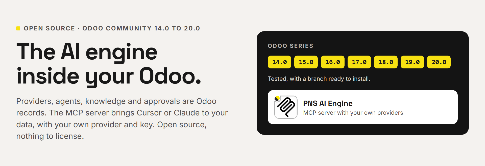
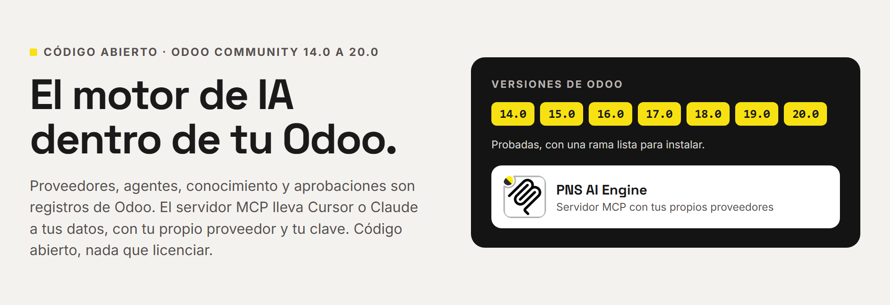

# PNS AI Engine (pns_ai_mcp)



**[English](#english) · [Español](#español) · [www.patanegra.com](https://www.patanegra.com/ai-engine.html)**

## English

**AI inside your Odoo, for consultants.** The AI Engine runs in your client's
Odoo. Providers, agents, knowledge and approvals are Odoo records, and the
agents live in plain Odoo modules. Open source, nothing to license. Odoo
**14.0** to **20.0**.

### The pain

**AI for your clients as just another module. Open source, no licences.**
Not a service on the side that you connect client by client. An AI that
installs, updates and uninstalls like any other module, on the Odoo the
client already runs. Here the agents live in plain Odoo modules.

| | |
| :--- | :--- |
| **01 — Tied to one provider?** | Add several, each for its job: conversation, audio, vision, video. If one fails, the next one answers. |
| **02 — What if the AI writes in production?** | Its code runs in a read-only sandbox. To change anything it proposes a plan, and a person approves it. |
| **03 — A closed prompt that does not know your client?** | Contexts are edited and extended inside Odoo: their vocabulary, their rules, their habits. |

### What you get

**Agents that are Odoo**
- An agent is a record that a module brings with it. Install the module and the agent is there; uninstall it and it goes.
- Each agent has its own list of providers, in the order you set.
- Everything is in the client's database: no second copy somewhere else.

**Providers for each task**
- OpenAI and any OpenAI-compatible endpoint, Anthropic, OpenRouter. A local model (Ollama, LM Studio) on the client's own server works too.
- Roles per provider: conversation, audio, vision, video, page layout, turning a phrase into a skill's fields, yes-or-no decisions.
- If one provider fails, the next one in the list answers.
- The key stays in the client's database, never in the module.

**A sandbox and a person**
- The code the AI writes reads in a read-only transaction, with the rights of the person who asked.
- A change to Odoo is a plan that waits for a person to approve it in Odoo.
- Every call is logged: each user sees their own activity, the administrator sees all of it.
- Outside addresses only from a whitelist you keep.

**Knowledge you own**
- Contexts: the client's words, rules and habits, edited in Odoo.
- Skills: procedures written once and launched by name. Their tables and charts come from code, not from the AI.
- Export the whole AI setup of one client to a file and import it at the next one.

**An MCP server in the client's Odoo**
- Cursor and other MCP clients connect to `/mcp` with a personal key.
- No admin password goes anywhere. Each key reads with its user's rights.
- The client's own model does the thinking; Odoo answers its tool calls. No provider needed for that.

**Nothing to license**
- Apache 2.0. No fee per user, per database or per year.
- A plain Odoo module: no external server to run.
- Same module at every client on a supported series.

### Agents, roles and chains

**What an agent is.** Anything in Odoo that uses AI: a chat, a voice assistant, an MCP endpoint, a job that runs in the background. In the engine it is a record (*AI Engine → Agents*) with a code, its contexts, its skills and its list of providers.

The natural home of an agent is the Odoo module that needs it: install the module and the agent is there; uninstall it and it goes. One module can bring more than one. This engine brings two:

- **MCP Server** (`pns_ai_mcp`) serves contexts and tools to an outside client such as Cursor. The model runs in that client; Odoo answers its tool calls.
- **AI Admin** (`pns_ai_admin`) does the engine's own jobs: writing a skill, reading an API's documentation.

[Chatboo](https://github.com/patanegra-soft/pns_ai_chatboo) brings the chat agent. An agent can also be created by hand in Odoo.

**Two kinds.** *Inference*: Odoo calls the model, through the agent's providers (a chat, a voice assistant). *Endpoint*: the model is outside and Odoo only serves it (MCP).

**Roles.** A role says what a provider is for. One provider can hold several.

| Role | What for |
| :--- | :--- |
| Conversation | The ordinary text turn. A provider with no role does the same. |
| Audio | A voice clip into text. |
| Vision | A photo or a scanned page. |
| Video | A video clip. |
| Decision | A closed yes or no, with a confidence. Nobody holding it means no. |
| Design | Lays out a page from the data of a turn. Nobody holding it: Conversation answers. |
| Parser | A short phrase into fields, such as the arguments of a skill. A small model is enough. Nobody holding it: Conversation answers. |

**The chain.** Each agent has its own providers, in the order you set. When a turn needs a role, the engine takes the providers of that agent that hold it, in that order. If one fails or stalls, the next one answers.

- Each link has its own timeouts: seconds with no data, and seconds for a whole round.
- A provider that holds only that role goes before the ones that do everything: it was chosen for that job.
- If the chain has nobody for a role other than Conversation, the engine looks among every active provider.
- **No external failover** ends the chain at that provider. Use it on a local model whose data must not go out.
- A key that reached its monthly spend cap is skipped.
- An agent with no chain uses every active provider.

For example: a large model for the conversation, a small one with only Parser, and a local model at the end of the chain as backup.

### What it does not do

- **No chat screen.** The engine has no conversation window for users. That is [Chatboo](https://github.com/patanegra-soft/pns_ai_chatboo).
- **No writes on its own.** The AI never changes Odoo by itself. Every change is a plan that a person approves in Odoo.
- **Four provider protocols.** OpenAI-compatible, OpenRouter, Anthropic and SystemOne (yes-or-no decisions). An API that speaks none of them does not connect.
- **Not before 14.0.** Tested and published from 14.0 to 20.0; 13.0 and older do not run (see *Odoo versions*).

### Questions

**Is it an MCP server?** It includes one, in the same module. `POST /mcp` speaks Streamable HTTP. `/mcp/sse` with `/mcp/message` is for clients that only speak SSE. `/mcp/<agent>` ties the call to one agent. Three tools: `relaxaicode` (read-only Python against Odoo), `safe_plan_request` (propose a change) and `safe_plan_status` (see whether it was approved).

**Where do the client's data go?** To the providers you set up, and to the outside addresses and API servers you allow. When Cursor or another MCP client connects, its own model sees what the tools return.

**Do I need Chatboo?** No. The engine alone serves MCP clients. Chatboo adds the chat inside Odoo and brings the engine with it.

**What is `pns_base`?** The shared layer of the PNS modules: the same screens load on Odoo 14 to 20, plus small helpers (notifications, import and export, PDF). It installs as a dependency.

### Getting started

1. **Install.** Want the chat too? Install [Chatboo](https://github.com/patanegra-soft/pns_ai_chatboo#getting-started) instead; it brings this module. For the engine alone, clone the branch of your series (`14.0` to `20.0`) of `pns_base` and `pns_ai_mcp`, add each clone to `addons_path` and install **PNS AI Engine** from Apps. On Odoo 14, first run `pip install "openpyxl>=3.1.2"`.
2. **Become AI administrator.** *Settings → Users*: give yourself **AI Administrator**. Log out and back in.
3. **Get your API key.** *AI Engine → Security → Users*: your row, tick **AI Conversational** and press **Generate API Key**.
4. **Add a provider.** *AI Engine → Connections → Providers*: protocol, endpoint, API key and model, with the **Conversation** role.
   Or start from a ready one: `static/examples/providers/` has OpenRouter, OVH, OpenAI, Anthropic and Lemonade, with no key. *Settings → AI Engine → Import configuration*, pick the file, then type your key in each provider.

**Done.** Point Cursor (or any MCP client) at `https://<your-odoo>/mcp` with the key in the `X-MCP-API-Key` header. Example below, in *Connecting an MCP client*.

### For IT staff

#### Connecting an MCP client

In Cursor, add the server to `~/.cursor/mcp.json` (all projects) or to
`.cursor/mcp.json` (one project). Other MCP clients take the same two
things: the URL and the header.

```json
{
  "mcpServers": {
    "my-client-odoo": {
      "url": "https://odoo.example.com/mcp",
      "headers": {
        "X-MCP-API-Key": "<your-api-key>"
      }
    }
  }
}
```

The key is the one from step 3 and reads with that user's rights. One key
per person; do not commit the file with the key in it.

#### Repository layout

`main` is one tree for every series. A flat branch (`14.0` … `20.0`) is that tree built for one series, ready for the addons path.

| Path | Contents |
| :--- | :--- |
| `common/` | Version-agnostic code, skills, contexts, data, Apps sheet |
| `stacks/owl1/pns_ai_mcp/` | Odoo 14 and 15 |
| `stacks/owl2/pns_ai_mcp/` | Odoo 16 to 19 |
| `stacks/owl3/pns_ai_mcp/` | Odoo 20 and later |

The installer overlays `common/` then the stack; a stack file with the same
path wins. Edit agnostic files only in `common/`. Build a flat module with
`./install_flat.sh 19.0 /path/to/addons`. Domain UI helpers: `utils/mcp_ui.py`.

Python: do not add `requests` or `reportlab` (Odoo already ships them).
`pns_base` needs no extra pip. On 14, use a current `openpyxl` (old wheels
break with recent NumPy).

#### Odoo versions

| Series | Status |
| :--- | :--- |
| 14.0 – 20.0 | Tested. Flat branch published. |
| 13.0 and older | Not supported. |

Odoo 13 has no OWL, which the AI chat is built on. Odoo 8 to 12 run on a
Python older than 3.7, which the engine needs. The suite keeps three stacks (`owl1` for 14.0 and 15.0, `owl2` for 16.0 to 19.0, `owl3` for 20.0 and later).

#### Tests

| Where you are | What runs |
| :--- | :--- |
| `main` | `python -m pytest unit_tests`, with no Odoo. Then the Odoo tests, after `./install_flat.sh 19.0 <dir>`. |
| A flat branch (`14.0` … `20.0`) | The Odoo tests in `tests/`. The unit tests live on `main`. |

```bash
odoo-bin -d <db> -i pns_ai_mcp --test-enable --stop-after-init --test-tags /pns_ai_mcp
```

### License, marks, training

Apache-2.0 — see [LICENSE](LICENSE) and [NOTICE](NOTICE).
PATANEGRA Soft™ and PAAP™ (Patanegra Application Agent Protocol, which this
engine implements) are trademarks of PATANEGRA Soft SL; the license does
not grant them. TDM / AI training is allowed (TDMRep `tdm-reservation = 0`).

Security: [SECURITY.md](SECURITY.md). Bugs, ideas and questions: [CONTRIBUTING.md](CONTRIBUTING.md).

---

## Español



**IA dentro de tu Odoo, para consultores.** El Motor de IA corre en el Odoo
de tu cliente. Proveedores, agentes, conocimiento y aprobaciones son registros
de Odoo, y los agentes viven en módulos normales de Odoo. Código abierto, nada
que licenciar. Odoo **14.0** a **20.0**.

### El dolor

**IA para tus clientes como un módulo más. Código abierto, sin licencias.**
No un servicio al lado que conectas cliente a cliente. Una IA que se instala,
se actualiza y se desinstala como cualquier otro módulo, en el Odoo que el
cliente ya tiene. Aquí los agentes viven en módulos normales de Odoo.

| | |
| :--- | :--- |
| **01 — ¿Atado a un proveedor?** | Pon varios, cada uno para lo suyo: conversación, audio, imagen, vídeo. Si uno cae, responde el siguiente. |
| **02 — ¿Y si la IA escribe en producción?** | Su código corre en una caja de arena de solo lectura. Para cambiar algo propone un plan, y lo aprueba una persona. |
| **03 — ¿Un prompt cerrado que no conoce a tu cliente?** | Los contextos se editan y se amplían en el propio Odoo: su vocabulario, sus reglas, sus costumbres. |

### Qué te llevas

**Agentes que son Odoo**
- Un agente es un registro que trae un módulo. Instalas el módulo y el agente está; lo desinstalas y se va.
- Cada agente tiene su propia lista de proveedores, en el orden que tú pongas.
- Todo está en la base de datos del cliente: no hay una segunda copia en otro sitio.

**Proveedores para cada tarea**
- OpenAI y cualquier servicio compatible con OpenAI, Anthropic, OpenRouter. También un modelo local (Ollama, LM Studio) en el propio servidor del cliente.
- Roles por proveedor: conversación, audio, imagen, vídeo, maquetar una página, pasar una frase a los campos de un skill, decisiones de sí o no.
- Si un proveedor falla, responde el siguiente de la lista.
- La clave se queda en la base de datos del cliente, nunca en el módulo.

**Una caja de arena y una persona**
- El código que escribe la IA lee en una transacción de solo lectura, con los permisos de quien preguntó.
- Un cambio en Odoo es un plan que espera a que una persona lo apruebe en Odoo.
- Cada llamada queda registrada: cada usuario ve su actividad, el administrador la de todos.
- Direcciones de fuera, solo las de una lista blanca que tú mantienes.

**Conocimiento tuyo**
- Contextos: las palabras, reglas y costumbres del cliente, editadas en Odoo.
- Skills: procedimientos que se escriben una vez y se lanzan por su nombre. Sus tablas y gráficos salen del código, no de la IA.
- Exportas toda la configuración de IA de un cliente a un fichero y la importas en el siguiente.

**Un servidor MCP en el Odoo del cliente**
- Cursor y otros clientes MCP se conectan a `/mcp` con una clave personal.
- Ninguna contraseña de administrador sale de Odoo. Cada clave lee con los permisos de su usuario.
- Piensa el modelo del propio cliente MCP; Odoo responde a sus llamadas. Para eso no hace falta proveedor.

**Nada que licenciar**
- Apache 2.0. Sin cuota por usuario, por base de datos ni por año.
- Un módulo de Odoo normal: sin servidor externo que mantener.
- El mismo módulo en todos los clientes de una versión soportada.

### Agentes, roles y cadenas

**Qué es un agente.** Cualquier cosa de Odoo que use IA: un chat, un asistente de voz, un punto MCP, un trabajo que corre por detrás. En el motor es un registro (*Motor de IA → Agentes*) con un código, sus contextos, sus skills y su lista de proveedores.

Lo natural es que un agente venga con el módulo de Odoo que lo necesita: instalas el módulo y el agente está; lo desinstalas y se va. Un módulo puede traer más de uno. Este motor trae dos:

- **MCP Server** (`pns_ai_mcp`) da contextos y herramientas a un cliente de fuera, como Cursor. El modelo corre en ese cliente; Odoo contesta a sus llamadas.
- **AI Admin** (`pns_ai_admin`) hace los trabajos del propio motor: escribir un skill, leer la documentación de una API.

[Chatboo](https://github.com/patanegra-soft/pns_ai_chatboo) trae el agente del chat. También se puede crear un agente a mano en Odoo.

**Dos tipos.** *Inferencia*: Odoo llama al modelo, con los proveedores del agente (un chat, un asistente de voz). *Endpoint*: el modelo está fuera y Odoo solo le sirve (MCP).

**Roles.** Un rol dice para qué sirve un proveedor. Un proveedor puede tener varios.

| Rol | Para qué |
| :--- | :--- |
| Conversación | El turno de texto normal. Un proveedor sin rol hace lo mismo. |
| Audio | Un audio de voz a texto. |
| Visión | Una foto o una página escaneada. |
| Vídeo | Un vídeo. |
| Decisión | Un sí o un no cerrado, con su confianza. Si nadie lo tiene, es no. |
| Diseño | Maqueta una página con los datos de un turno. Si nadie lo tiene, contesta Conversación. |
| Parser | Una frase corta a campos, como los argumentos de un skill. Basta un modelo pequeño. Si nadie lo tiene, contesta Conversación. |

**La cadena.** Cada agente tiene sus proveedores, en el orden que pongas. Cuando un turno necesita un rol, el motor toma los proveedores de ese agente que lo tienen, en ese orden. Si uno falla o se queda colgado, contesta el siguiente.

- Cada enlace tiene sus tiempos de espera: segundos sin datos y segundos para una ronda entera.
- Un proveedor que solo tiene ese rol va antes que los que hacen de todo: se eligió para eso.
- Si la cadena no tiene a nadie para un rol que no sea Conversación, el motor busca entre todos los proveedores activos.
- **Sin failover externo** corta la cadena en ese proveedor. Sirve para un modelo local cuyos datos no deben salir.
- Una clave que llegó a su tope de gasto del mes se salta.
- Un agente sin cadena usa todos los proveedores activos.

Por ejemplo: un modelo grande para la conversación, uno pequeño solo con Parser, y un modelo local al final de la cadena como respaldo.

### Qué no hace

- **Sin pantalla de chat.** El motor no trae ventana de conversación para los usuarios. Eso es [Chatboo](https://github.com/patanegra-soft/pns_ai_chatboo).
- **No escribe por su cuenta.** La IA nunca cambia Odoo sola. Cada cambio es un plan que aprueba una persona en Odoo.
- **Cuatro protocolos de proveedor.** Compatible con OpenAI, OpenRouter, Anthropic y SystemOne (decisiones de sí o no). Una API que no hable ninguno no se conecta.
- **No antes de la 14.0.** Probado y publicado de la 14.0 a la 20.0; la 13.0 y anteriores no funcionan (ver *Versiones de Odoo*).

### Preguntas

**¿Es un servidor MCP?** Lo incluye, en el mismo módulo. `POST /mcp` habla Streamable HTTP. `/mcp/sse` con `/mcp/message` es para clientes que solo hablan SSE. `/mcp/<agente>` ata la llamada a un agente. Tres herramientas: `relaxaicode` (Python de solo lectura contra Odoo), `safe_plan_request` (proponer un cambio) y `safe_plan_status` (ver si se aprobó).

**¿Adónde van los datos del cliente?** A los proveedores que configures, y a las direcciones de fuera y servidores de API que permitas. Cuando se conecta Cursor u otro cliente MCP, su propio modelo ve lo que devuelven las herramientas.

**¿Necesito Chatboo?** No. El motor solo ya sirve a clientes MCP. Chatboo añade el chat dentro de Odoo y trae el motor con él.

**¿Qué es `pns_base`?** La capa común de los módulos PNS: las mismas pantallas cargan de Odoo 14 a 20, y trae utilidades pequeñas (avisos, importar y exportar, PDF). Se instala como dependencia.

### Puesta en marcha

1. **Instala.** ¿Quieres también el chat? Instala [Chatboo](https://github.com/patanegra-soft/pns_ai_chatboo#puesta-en-marcha); trae este módulo. Solo el motor: clona la rama de tu versión (de la `14.0` a la `20.0`) de `pns_base` y de `pns_ai_mcp`, añade cada clon al `addons_path` e instala **PNS AI Engine** desde Aplicaciones. En Odoo 14, antes, `pip install "openpyxl>=3.1.2"`.
2. **Hazte administrador de IA.** *Ajustes → Usuarios*: date **IA Administrador**. Sal y vuelve a entrar.
3. **Saca tu clave API.** *Motor de IA → Seguridad → Usuarios*: tu fila, marca **IA Conversacional** y pulsa **Generar Clave API**.
4. **Pon un proveedor.** *Motor de IA → Conexiones → Proveedores*: protocolo, dirección, clave API y modelo, con el rol **Conversación**.
   O parte de uno hecho: en `static/examples/providers/` están OpenRouter, OVH, OpenAI, Anthropic y Lemonade, sin clave. *Ajustes → Motor de IA → Importar configuración*, eliges el fichero y escribes tu clave en cada proveedor.

**Listo.** Apunta Cursor (o cualquier cliente MCP) a `https://<tu-odoo>/mcp` con la clave en la cabecera `X-MCP-API-Key`. Ejemplo más abajo, en *Conectar un cliente MCP*.

### Para el equipo de IT

#### Conectar un cliente MCP

En Cursor, añade el servidor a `~/.cursor/mcp.json` (todos los proyectos) o a
`.cursor/mcp.json` (un proyecto). Los demás clientes MCP piden lo mismo: la
dirección y la cabecera.

```json
{
  "mcpServers": {
    "odoo-de-mi-cliente": {
      "url": "https://odoo.example.com/mcp",
      "headers": {
        "X-MCP-API-Key": "<tu-clave-api>"
      }
    }
  }
}
```

La clave es la del paso 3 y lee con los permisos de ese usuario. Una clave
por persona; no subas a git el fichero con la clave dentro.

#### Estructura del repositorio

`main` es un solo árbol para todas las versiones. Una rama plana (`14.0` … `20.0`) es ese árbol construido para una versión, listo para el addons path.

| Ruta | Contenido |
| :--- | :--- |
| `common/` | Código común a todas las versiones, skills, contextos, datos, ficha de Apps |
| `stacks/owl1/pns_ai_mcp/` | Odoo 14 y 15 |
| `stacks/owl2/pns_ai_mcp/` | Odoo 16 a 19 |
| `stacks/owl3/pns_ai_mcp/` | Odoo 20 y siguientes |

El instalador copia `common/` y encima la pila; si un fichero está en los dos,
gana el de la pila. Lo común se edita solo en `common/`. El módulo plano de
una versión se construye con `./install_flat.sh 19.0 /ruta/a/addons`.
Utilidades de interfaz del dominio: `utils/mcp_ui.py`.

Python: no añadas `requests` ni `reportlab` (ya vienen con Odoo). `pns_base`
no necesita nada de pip. En la 14, usa un `openpyxl` reciente (los antiguos
fallan con NumPy moderno).

#### Versiones de Odoo

| Versión | Estado |
| :--- | :--- |
| 14.0 – 20.0 | Probadas. Rama plana publicada. |
| 13.0 y anteriores | No soportadas. |

Odoo 13 no tiene OWL, sobre el que está hecho el chat. De Odoo 8 a 12 usan un
Python anterior al 3.7, que es el que necesita el motor. La suite mantiene tres pilas (`owl1` para la 14.0 y la 15.0, `owl2` de la 16.0 a la 19.0 y `owl3` para la 20.0 y siguientes).

#### Tests

| Dónde estás | Qué se ejecuta |
| :--- | :--- |
| `main` | `python -m pytest unit_tests`, sin Odoo. Después los tests de Odoo, tras `./install_flat.sh 19.0 <dir>`. |
| Una rama plana (`14.0` … `20.0`) | Los tests de Odoo en `tests/`. Los unitarios viven en `main`. |

```bash
odoo-bin -d <db> -i pns_ai_mcp --test-enable --stop-after-init --test-tags /pns_ai_mcp
```

### Licencia, marcas, entrenamiento

Apache-2.0: ver [LICENSE](LICENSE) y [NOTICE](NOTICE).
PATANEGRA Soft™ y PAAP™ (Patanegra Application Agent Protocol, que implementa
este motor) son marcas de PATANEGRA Soft SL; la licencia no las concede. Se
permite la minería de textos y el entrenamiento de IA (TDMRep `tdm-reservation = 0`).

Seguridad: [SECURITY.md](SECURITY.md). Errores, ideas y preguntas: [CONTRIBUTING.md](CONTRIBUTING.md).
